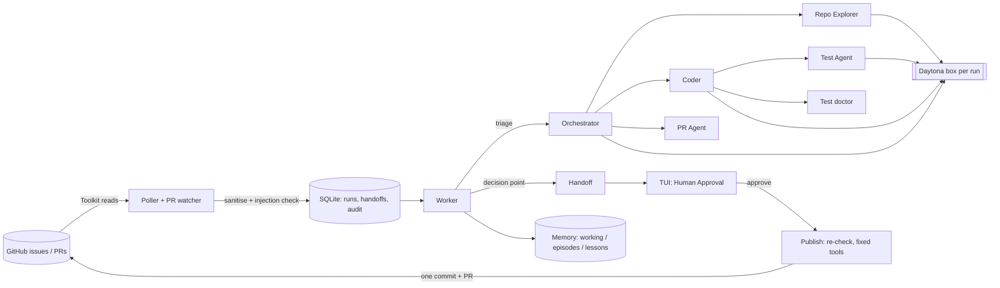

# CodePilot+

CodePilot+ turns GitHub issues labelled `ai-assignable` into tested pull requests. A team of AI agents (built with DeepAgents and LangGraph) explores the repository, changes the code in an isolated sandbox, runs the tests and drafts the pull request; a person approves every change in a terminal UI before anything reaches GitHub. Tags used below: **Brief** = required by the assignment, **Bonus** = the assignment's bonus list, **Plus** = added by CodePilot+.

## Demo

FILL: YouTube (unlisted) link to the ~7-minute demo, then the TUI GIF (under 5 MB): ``.

## Setup

    uv tool install git+https://github.com/LijiAlex/codepilot-agent
    cp codepilot.example.yml codepilot.yml        # list your repositories, test and install commands
    export ANTHROPIC_API_KEY=...                   # solver model
    export CODEPILOT_GH_APP_ID=... CODEPILOT_GH_APP_KEY_PATH=~/.codepilot/keys/app.pem
    export DAYTONA_API_KEY=...                     # remote sandbox (or set `sandbox: local`)
    # optional: `injection_checker: bedrock` + AWS_PROFILE to screen issues with an AWS Bedrock guardrail instead of NeMo
    codepilot selfcheck && codepilot

GitHub App permissions: Contents, Pull requests and Issues read & write; Metadata read; no Workflows. FILL: anything that changed during the build.

## Architecture

One Python process: the TUI on the main thread, with background threads for the poller and PR watcher, the worker (one run at a time) and decisions, all sharing one SQLite database. Each run gets its own Daytona box, cloned from a git bundle (no GitHub credential inside), deleted when the run ends.

## How it works

1. **Poll (Brief)** every 5 minutes through the GitHub Toolkit; skip issues already in progress, failed recently or already on a branch; sanitise and screen the text (Brief guardrails: NeMo Guardrails input rails).
2. **Triage (Brief, Bonus complexity score)**: one of five task types picks a skill; above the threshold a read-only plan goes to the TUI first (Plus).
3. **Explore → code → test (Brief)**: Repo Explorer (repo map + keyword/embedding search) → Coder → Test Agent, in a fresh sandbox with no credentials.
4. **Gates (Brief)**: nothing waits on a person — a decision becomes a TUI item and the run ends (Plus).
5. **Publish (Brief)**: after approval, code re-checks the issue and `main`, then the PR Agent opens one commit and one PR with labels and a review request.
6. **Memory (Brief)**: working state per run, episodes per session, lessons from merged PRs (Plus: also from failures and rejections).

## Example pull request

FILL: link to a merged CodePilot+ PR on `layered-memory` and one on `codepilot-playground`.

## Guardrails

Issue text passes two layers before any agent sees it: the sanitiser (removes HTML comments, hidden characters, link titles, image alt text) and **NeMo Guardrails** input rails — a regex rail for unambiguous attacks (no model call) and the LLM self-check rail (`guardrails/nemo/config.yml`). If the screen cannot answer, the issue is held back (fails closed).

Measured on 27 labelled issues (`evals/issues.yaml`; the benign ones are deliberately code-heavy — stack traces, shell snippets, the words "ignore", "override", "delete"):

| Measure | Result |
|---|---|
| Malicious issues blocked by NeMo | 10/12 (the other 2 hid their payload in an HTML comment and a link title, which the sanitiser had already removed — 12/12 never reach an agent) |
| Benign issues wrongly blocked | 0/15 |
| Screen unavailable (failed closed) | 0 |
| Latency p50 / p95 | 828 ms / 1258 ms |

FILL: the scoreboard rows for refused commands and unexpected-command decisions (`scripts/scoreboard.py`).

## Results

FILL: paste `results/playground.md` (expected outcome reached, hidden tests passed, tokens and minutes per issue) and `scripts/scoreboard.py` output.

Context engineering (FILL from the dashboard's Context page and `scripts/map_proof.py`): repo map tokens vs the 4,000 budget, files shown, top-K = 10 files returned by the Explorer, files read before the right one, lessons recalled per run, and the large-repository proof (Django: 7,084 files → 3,978 tokens).

## Observability

FILL: `` — one run's trace (Orchestrator → Explorer → Coder → Test Agent → PR Agent); inputs and outputs are redacted before upload. Every action is also in the local audit log (`codepilot dashboard` → Audit).

## Key design decisions

- Handoffs instead of waiting: a run never holds a sandbox while a person decides.
- Fixed publish tools: the commit is built from the exact approved change; the agent supplies only text.
- Per-agent tool lists and write permissions, checked at every start-up.
- Remote sandbox per run, cloned from a git bundle: no GitHub credential ever enters it.
- A change counts as tested only if the last `verify` test run came after the last edit; a passing "reproduce" run never counts.
- A decision interrupted by a shutdown (e.g. mid-publish) is put back in the approval list at start-up; re-approving is safe because the publish tools are idempotent.
- Untrusted issue text is never rendered as markup in the TUI and never as HTML in the dashboard.
- The dashboard merges only when the latest independent review is for the current commit and says merge-ready.

## Known limitations

- Daytona's free tier cannot block outbound network traffic; the sandbox holds no credentials and the shell guard refuses network tools, but egress itself is open (measured 2026-10-17 on a live box: outbound reachable; box start-up 9.6 s).
- The local fallback sandbox (macOS `sandbox-exec`: no network, no writes outside the run, CodePilot+'s own files unreadable) is weaker than a remote box.
- The command guard is a policy filter, not the security boundary: `python` and `pytest` run repository code by design, so the sandbox is the boundary.
- The Independent Reviewer skips pull requests from forks, and its "tests green" signal comes from a job that runs the PR's own code.
- LangSmith keeps traces 14 days; README screenshots stand in for links.
- If `main` changed 300 or more files since the run started, GitHub's compare API cannot list them all, so publishing is refused as a possible conflict.
- Claude Sonnet 5.5 accepts only the default sampling temperature, so runs are not deterministic.

## Future improvements

Ideas that came up while building and testing, deliberately left out of this version:

- **Promote lessons from repo skills to task skills.** Task skills (the five playbooks) stay generic and fixed; everything repository-specific lives in each repo skill. A safe next step: when the same gotcha has been approved in the repo skills of at least two repositories (for example "inline `python -c` is refused — read the file instead"), propose it as an addition to the matching task skill. Additions only — a learned change may never remove or soften a "Must not" rule or the workflow steps — with its own approval and versions.
- **Current repo skill view.** The Skills tab lists each version's change; it could also show the full text the agents read for any version, with the steps each version added or retired, and its size against the 1,500-token budget.
- **Smarter merging of skill proposals.** Reworded proposals are merged by meaning (local embeddings) plus a shared file or command; an extra model check on borderline pairs (merge / keep both) would cut the rare wrong merge.
- **Tests for fork pull requests.** Fork PRs are reviewed from the diff only and their code is never run, so they are never marked merge-ready automatically. Running their tests in a separate throw-away sandbox with no secrets would let the reviewer score them fully.
- **Steadier triage.** The same issue can be classified differently on different runs (for example bug fix one time, feature addition the next). Remembering the first classification per issue, or asking twice and taking the majority, would make retries consistent.
- **Blocking outbound network in the sandbox.** The shell guard refuses network tools, but the remote box itself can reach the internet on the current plan; a paid sandbox tier or an egress allow-list would close that.
- **Cost limits per run in dollars.** Runs are bounded by model calls, tool calls and minutes; LangSmith already prices every call, so a dollar ceiling per run (and per day) is a small step.
- **Pull request page extras.** CI status from GitHub, sorting, and a direct "re-review" button that adds the `codepilot-review-pending` label.

## Brief vs CodePilot+

| Brief | CodePilot+ | Why |
|---|---|---|
| Approval panel waits for a keypress | Item waits; agent saves work and moves on (handoff) | No idle sandbox/agent; nothing goes stale |
| Ask before `git push`; ask a person on every blocked command | Push refused and logged; the only route to GitHub is the publish step, which always needs approval. Known never-needed commands are refused without interrupting anyone; only unexpected commands ask a person | Fewer interruptions, same protection; the sandbox has no GitHub access |
| PR Agent commits/opens PR with Toolkit `create_*` | PR Agent opens the PR after approval, using fixed tools that replace the Toolkit write tools | Toolkit commits one file per call, has no labels, and its tool names are rejected by AI providers |
| NeMo Guardrails | NeMo Guardrails input rails (regex + LLM self-check on Claude Haiku) screen issue text; custom Python guards commands, file writes and the change set | As the brief asks; the self-check model needed a small adapter because Claude 5 models reject NeMo's fixed `temperature` |
| Local sandbox, repo subset | Daytona, full clone; local fallback | Local backend has no isolation; tests need whole repo |
| `Permission(path, access)`, `summarization=True` | `FilesystemPermission(operations, paths, mode)`; summarisation always on | Real 0.7.23 API |
| Subagents spawn subagents | Coder is a compiled deep agent | Declarative subagents get no `task` tool |
| GitHubToolkit (langchain-community) | Used for read tools only | langchain-community prints "being sunset, no longer actively maintained" (0.4.2) |
| Triage inside Orchestrator | Orchestrator's classification step runs before the graph is built | Graph is built for the chosen skill/subagents |

Also:
- Polling with the Toolkit runs in plain code, not inside the Orchestrator agent (cheaper; the agent only sees its claimed issue).
- Skills are structured objects loaded by CodePilot+ (`codepilot:` front matter) rather than mounted through `deepagents.skills`.
- Labelled issues above the complexity threshold get a plan for a person to approve instead of being skipped; unassigned ones above it are skipped (brief bonus).
- "In-progress issue IDs" are database claims (one active run per issue), shared by every thread.
- The repo map is built by code at run start and written to `/shared/repo_map.md` (the agents' virtual file system), not by the Explorer with `write_file`.
- Blocked commands are refused with a reason, not escalated; only commands nobody has classified go to a person.
- Lint-on-edit uses `py_compile`; the repo map's LLM file descriptions are off; a release regex scan replaces gitleaks.

## Credits

Injection guardrail: my Assignment 3 project, used as a package (`guardrail-eval-pipeline` v0.2.0). Playground: a copy of that project with planted defects. Built with DeepAgents, LangGraph, LangChain, Textual, ChromaDB, PyGithub and Daytona.
