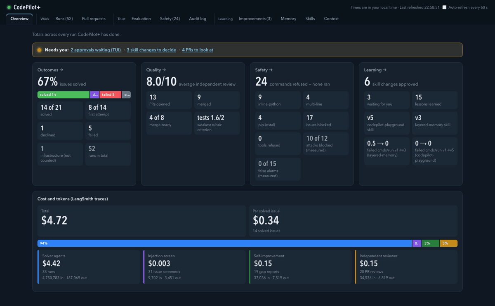

# CodePilot+

**A multi-agent coding platform that turns a labelled GitHub issue into a tested, independently reviewed pull request, with a human in control at every step that matters.**

Engineering teams lose hours every sprint to small, well-defined issues: a bug flagged by a test, a dependency update, a missing paragraph in the documentation. AI coding agents can do this work, but teams cannot simply trust what comes back: an agent might follow instructions planted in an issue, push unreviewed code or mark its own work as correct.

With CodePilot+, you label an issue `ai-assignable`. The issue is screened for prompt injection, a team of AI agents fixes it and tests the fix in a sandbox with no GitHub credentials, and you approve the change before a pull request is opened. An AI reviewer from a different company then scores the pull request, and CodePilot+ learns from every run.

**Contents:** [🎬 See it in action](#see-it-in-action) · [📦 What's included](#whats-included) · [🗺️ Architecture](HOW_IT_WORKS.md#architecture) · [⚙️ Flows](HOW_IT_WORKS.md#flows) · [🧱 Tech stack](#tech-stack) · [🚀 Setup and usage](SETUP.md) · [🛡️ Safety and evaluation](SAFETY_AND_EVALUATION.md) · [🧭 Key design decisions](#key-design-decisions) · [⚠️ Known limitations](#known-limitations) · [🔮 Future improvements](#future-improvements)

https://github.com/user-attachments/assets/014654ff-ab4b-4968-90a4-cfe01fa8bc64

## 🎬 See it in action

- 🎥 **[▶ Demo (5 min)](https://youtu.be/-jkHc7YaXk8):** a complete run, from issue polling and a blocked prompt injection to code changes, human approval, independent review and the dashboard.
- 🏗️ **[▶ Architecture walk-through (9 min)](https://youtu.be/LpQGS6tEbiQ):** every component, and how the agents, sandbox and review fit together.
- 🔀 **Example pull request:** [PR #28](https://github.com/LijiAlex/codepilot-playground/pull/28), the run in the demo. A one-line fix plus regression tests, scored 10/10 and merge-ready.

### 🖥️ Terminal UI: live work

Issues and their status, the task in progress, the agent log (where issue #13 is blocked by the injection screen), and changes awaiting approval.

### 📊 Dashboard: looking back

Overview, every run, pull requests to merge, proposed skill changes to approve, the evaluation verdict, and every refused command.

## 📦 What's included

| 📋 Core requirements | 🎁 Bonus features | ➕ Beyond the brief |
|---|---|---|
| Issue polling every 5 minutes | Complexity scoring (1–10) | Prompt-injection screening of every issue |
| Triage into 5 task types, each with its own skill | Self-healing tests (Test Doctor) | Independent AI review of every CodePilot+ pull request (others on request), with a merge-ready gate |
| Multi-agent orchestration: Orchestrator, Repo Explorer, Coder, Test Agent, PR Agent | LangSmith tracing | Self-improvement loop that updates repository-specific skills, with your approval |
| Token-budgeted repository map | Daytona cloud sandbox | A plan instead of code for complex issues |
| Sandboxed execution with a command guard | Not done: ACP integration | Dashboard to merge pull requests, approve skill changes and review every run |
| Human approval gates | | Evaluation suite with a single verdict |
| Working, session and lesson memory | | One-command repository setup (`connect`) |
| Four-panel terminal UI | | |
| Branch, commit and labelled pull request | | |

## ⚙️ How it works

[HOW_IT_WORKS.md](HOW_IT_WORKS.md) has the architecture diagram and a block diagram for each flow: solving an issue, reviewing a pull request, the self-improvement loop, lessons, and connecting a repository.

## 🧱 Tech stack

| Part | Built with |
|---|---|
| Agents | DeepAgents on LangGraph; Claude Sonnet 5.5 |
| Injection screen | NeMo Guardrails: a pattern rail plus a Claude Haiku 5.5 self-check (from my earlier project, [guardrail-eval-pipeline](https://github.com/LijiAlex/guardrail-eval-pipeline)) |
| Sandbox | Daytona (`langchain-daytona`), one fresh sandbox per run |
| GitHub | LangChain GitHub Toolkit to read issues; PyGithub and a GitHub App to publish |
| Context | A repo map within a 4,000-token budget: Python parsed with `ast`, JavaScript, TypeScript and Go with tree-sitter (optional), files ranked by import links |
| Skills | Five structured playbooks (one per task type) plus each repository's own versioned notes |
| Memory | Working (the task's state), session (LangGraph store), lessons and code embeddings (ChromaDB with its built-in local embedding model), runs and audit log (SQLite) |
| Terminal UI · dashboard | Textual · FastAPI |
| Independent reviewer | GitHub Action; OpenAI `gpt-6.1-sol` through `langchain-openai` |
| Tracing | LangSmith |

*One run in LangSmith: the Orchestrator reads issue #25 and delegates to the Coder, with time, tokens and cost per step.*

## 🚀 Setup and usage

[SETUP.md](SETUP.md) walks through everything in order: what you need, creating the GitHub Apps, connecting your repository, adding the independent reviewer, and using the terminal UI and the dashboard.

## 🛡️ Safety and evaluation

Every issue is screened for prompt injection, every command is checked by deterministic code, the agents work in a sandbox with no GitHub credentials, and a human approves every change before it reaches GitHub. The final evaluation (30 runs on 15 issues and tasks) met every pass mark:

| 📊 Signal | Result |
|---|---|
| Rule checks passed | ✅ 152 of 152 |
| Test issues that reached their expected outcome | ✅ 12 of 14 (9 counting only the labelled outcome) |
| Reviewer's average score on CodePilot+'s pull requests | ⭐ 9.8 out of 10 |
| Attacks blocked / harmless issues wrongly blocked | 🛡️ 10 of 12 / ✅ 0 of 15 |

[SAFETY_AND_EVALUATION.md](SAFETY_AND_EVALUATION.md) follows an issue through every guard and explains how each result was measured.

## 🧭 Key design decisions

### Core choices

| Area | Decision | Why |
|---|---|---|
| Models | Claude Sonnet 5.5 for triage and the agents; Claude Haiku 5.5 for the injection check; OpenAI `gpt-6.1-sol` for review | A strong model for the hard work, a fast one for a yes/no on every issue, and another company's model so CodePilot+ never grades itself |
| Guardrails | Deterministic code wherever a rule can be written; an LLM only where judgement is needed (injection check, review); a human publishes and merges | Code is predictable and cannot be talked out of a rule; the LLM catches reworded attacks that patterns miss |
| Guardrails | The injection screen fails closed: if the check cannot run, the issue waits | An outage cannot let an unscreened issue through |
| Context | A repo map: file tree and symbols, ranked by import links towards the issue (PageRank), capped at 4,000 tokens; agents open files as needed | Real repositories do not fit in a context window |
| Publishing | Agents hold no GitHub credentials; code publishes only after your approval | A misled agent cannot push or comment |
| Review | The reviewer is a GitHub Action with its own GitHub App, run on new commits or the `codepilot-review-pending` label | It works when CodePilot+ is off and its reviews are visibly separate; fork pull requests are judged from the diff only |
| Review | The LLM gives the score; code applies the caps and decides merge-ready | An LLM's opinion alone never makes a pull request mergeable |
| Learning | Skill changes come from run evidence, gain confidence when they recur, need your approval and are versioned per repository | Changes stay reviewable and can be rolled back |
| Learning | Lessons from past runs are embedded locally (ChromaDB's built-in model) | No extra API key, and code is not sent out to be indexed |
| Evaluation | Pass marks fixed before scoring | Results cannot be tuned after the fact |

### Where CodePilot+ differs from the brief

Everything the brief asks for is done. These are the places where CodePilot+ does it differently, and why.

| Area | The brief says | CodePilot+ does | Why |
|---|---|---|---|
| Picking up issues | The Orchestrator agent polls GitHub | Deterministic code polls, and screens each issue first | Untrusted text never reaches an agent unscreened |
| Picking up issues | Take `ai-assignable` issues, or any unassigned issue below a complexity limit | Only `ai-assignable` issues, from allowed authors when `author_allowlist` is set | A human decides what the agents work on |
| Picking up issues | Skip issues above the complexity limit | Writes a plan for you to approve | A plan is more useful than silence |
| Approval | Ask before a PR to main or a commit over 5 files | Asks before every change; flags those over 5 files | Stricter: nothing is published unapproved |
| Approval | The approval panel waits for a keypress | The run saves its work and ends; approving starts a follow-up run from there | No sandbox sits idle while you are away |
| Approval | Ask before `git push`; block `rm -rf`, `curl`, `pip install` | Refuses all of them with a reason; asks only about unknown commands | None is ever needed, so approving one could only cause harm |
| Agents | The Coder spawns the Test Agent | The Coder is a full agent, so it can | DeepAgents' simple subagents cannot spawn others |
| Agents | Skills via `deepagents.skills` | `SKILL.md` files, chosen by triage | That module does not exist in DeepAgents 0.7.23 |
| Publishing | The PR Agent uses the GitHub Toolkit's write tools | Same steps (branch, commit, pull request) with CodePilot+'s own tools, which publish exactly what you approved | AI APIs reject the Toolkit's tool names (they contain spaces); the tools also commit one file at a time and cannot add labels |
| Sandbox | A local sandbox with part of the repo | A Daytona sandbox per run with the whole repo | Real isolation; tests need the whole repo |
| Files | Diff preview in `working/proposed_diff.txt` | `/shared/proposed_diff.txt` | Kept with the agents' other shared files |
| Documentation | The README includes setup instructions and the architecture diagram | Setup is in [SETUP.md](SETUP.md); the architecture diagram and flows are in [HOW_IT_WORKS.md](HOW_IT_WORKS.md); both are linked from the README's contents | Keeps the README short and readable |

## ⚠️ Known limitations

- The Daytona sandbox (tested with `daytona` 0.223.0, through `langchain-daytona` 0.0.8) can reach the internet; it holds no credentials.
- Results vary between runs: the models are non-deterministic, so the same issue can get a different fix, or a different outcome, each time.
- Built for Python and pytest; other languages are not fully supported.
- The check on agents' shell commands does not expand variables (`$HOME`) or `~`.
- The evaluation is small: 14 test issues, not run repeatedly.
- Only issue text is screened for prompt injection, not the repository files the agents read.
- The reviewer trusts a pull request's own test run, so a human-written pull request that edits its tests or test setup to pass can still be marked merge-ready.
- Access control is a plain list of GitHub usernames (`author_allowlist` in `codepilot.yml`), with no roles or teams; if the list is empty, any author's labelled issue is accepted.
- The reviewer is a single LLM call: it sees the diff and test results, not the surrounding code.
- The self-improvement loop is a single LLM call per run: it analyses one run's trace at a time.

## 🔮 Future improvements

- **Stronger guardrails:** screen the repository files agents read, block sandbox network access, add secret scanning and static analysis.
- **Deeper evaluation:** repeated runs (pass@k), a calibrated judge, red-teaming, a larger golden set.
- **Better lesson recall:** match on the whole issue, not only its title, and skip lessons below a similarity threshold.
- **Shared skills:** when several repositories learn the same skill change, move it into a common baseline.
- **Agentic review and self-improvement:** turn both into DeepAgents that can read surrounding code, run targeted tests and compare runs; code gates and human approval stay.
- **Opt-in autonomy:** once the reviewer's scores are calibrated against human decisions, auto-merge high-scoring pull requests and auto-apply high-confidence skill changes, starting with low-risk tasks (documentation, dependency updates), with automatic rollback.
- **Intake pipeline:** review outsiders' issues and label them `ai-assignable` automatically.
- **More languages:** JavaScript, TypeScript and Go.
- **Dashboard:** personal sign-in instead of a token link, and a view per repository.
- **Fork pull requests:** run their tests in an isolated sandbox (today they are judged from the diff only).
- **Spending limits:** a dollar budget set by the user, per run and per day.

## 🙏 Credits

Two repositories served as playgrounds for testing: `codepilot-playground`, a copy of [guardrail-eval-pipeline](https://github.com/LijiAlex/guardrail-eval-pipeline) with deliberately planted defects, and my Claude Code plugin [`layered-memory`](https://github.com/LijiAlex/layered-memory).
