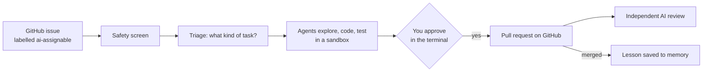

# CodePilot+

**An AI coding agent that picks up GitHub issues, fixes them in a sandbox, tests the fix, and opens a pull request — but only after a person approves it.**

Engineering teams lose hours every sprint to small, well-defined issues: a bug flagged by a test, a dependency bump, a missing paragraph in the docs. CodePilot+ takes those off the queue. You label an issue `ai-assignable`; a team of AI agents reads it, finds the relevant code, makes the change in an isolated copy of the repository, runs the tests, and prepares a pull request. Nothing reaches GitHub until you approve it in the terminal.

**Watch and read**

| | What it shows | Length |
|---|---|---|
| ▶ **Demo** — FILL: demo YouTube link | Issue polling, a full run from issue to pull request, a human approval, a guardrail block, and every dashboard tab | 5 min 13 s |
| ▶ **Architecture walkthrough** — FILL: architecture YouTube link | Every box on the architecture diagram, explained in order | 8 min 50 s |
| ▶ **Pitch** — FILL: pitch YouTube link | CodePilot+ in 30 seconds | 30 s |
| 📄 **Slide deck** — FILL: deck link | What is included (brief, bonus and beyond), how one issue flows through, the evaluation and results | 18 slides |


## How it works



1. **Watch.** Every 5 minutes CodePilot+ checks your repositories for open issues labelled `ai-assignable`.
2. **Screen.** The issue text is cleaned and checked for prompt injection (instructions hidden in an issue to trick the AI) before any agent reads it.
3. **Triage.** The issue is sorted into one of five task types — bug fix, feature, dependency update, documentation, configuration — and given a complexity score. The type decides which playbook (a *skill*) the agents follow. Issues that look too complex get a written plan for you to approve instead of code.
4. **Solve.** A team of agents works in a fresh sandbox (a throw-away copy of the repository on a remote machine, with no GitHub access): one maps the repository and finds the relevant files, one writes the change, one writes and runs tests.
5. **Approve.** When the change is ready — or when the agents want to do something unusual — the run saves its work and the item appears in the terminal's approval panel. You inspect the diff and approve or reject. Nothing waits idle in the meantime.
6. **Publish.** After approval, CodePilot+ re-checks the issue and the main branch, then commits exactly the approved change and opens one pull request, labelled and linked to the issue.
7. **Learn.** A separate AI reviewer scores every pull request. When a pull request is merged, CodePilot+ saves a short lesson it can recall the next time it meets a similar issue.

## Architecture


Blue boxes are AI agents or models, green boxes are plain code, and orange boxes are where a person decides. Pink PLUS tags mark what goes beyond the assignment brief.

## What's inside

**The agent team.** Built with [DeepAgents](https://github.com/langchain-ai/deepagents) on LangGraph. An Orchestrator plans each task as a checklist and hands work to a Repo Explorer, a Coder, a Test Agent and a PR Agent. Each agent gets only the tools it needs; the list is checked every time the app starts.

**Context that fits.** A real repository does not fit in a model's context window. CodePilot+ builds a *repo map* — the folder tree plus a one-line summary and the main functions of each file — ranked by relevance and cut to a 4,000-token budget. Agents read files only when they need them, and the Orchestrator calls the Repo Explorer only when the issue does not already point at the code (the Runs tab shows *skipped* in the Explored column when it went straight to the Coder). On Django (7,084 files) the map is about 3,978 tokens (estimated at four characters per token). Long agent conversations are summarised automatically: DeepAgents adds its summarization middleware to every agent by default.

**Safety.** Several independent layers:
- Issue text is cleaned (hidden comments, invisible characters) and screened by [NeMo Guardrails](https://github.com/NVIDIA/NeMo-Guardrails); if the screen cannot answer, the issue is held back.
- Every shell command an agent runs is checked first. Commands that are never needed (`rm -rf`, `curl`, `pip install`, `git push`, reading `.env`) are refused with a reason; commands nobody has classified are paused for you to decide.
- Agents can only write inside the sandbox, and never to secret files.
- Your approval is required to open a pull request, for any change touching more than 5 files, and before a third attempt after tests fail twice.

**Safety at a glance.** Every guard, the stage it acts at, and whether it is a fixed rule, an AI judgement or a person. AI is used only where judgement is needed, and each AI check is backed by a fixed rule or a person.

| What is guarded | Stage | How | AI or fixed rule |
|---|---|---|---|
| Who can assign work (issue author allowlist) | input | code | fixed rule |
| Hidden instructions in issue text, comments, changelogs and lessons | input | code: strip hidden content, wrap as untrusted | fixed rule |
| Obvious prompt injection | input | NeMo Guardrails regex rail | fixed rule |
| Subtler prompt injection | input | NeMo Guardrails self-check rail (Claude Haiku); the issue waits if the check cannot run | **AI** |
| *(alternative)* prompt injection | input | AWS Bedrock Guardrail from the earlier project, off by default (`injection_checker: bedrock`) | **AI** |
| Shell commands | execution | code: allow, refuse with a reason, or ask a person | fixed rule |
| Which tools each agent may call | execution | code: per-agent allowlist, checked at startup and on every call | fixed rule |
| Secret files (`.env`, keys, credentials, dot-folders) | execution | code: refused and hidden from listings | fixed rule |
| Where agents may write | execution | DeepAgents filesystem permissions | fixed rule |
| The machine and GitHub | execution | Daytona sandbox with no token and no remote | fixed rule |
| Runaway runs | execution | code: model and tool call caps, 30-minute limit, loop detector | fixed rule |
| "Tests pass" claims | before approval | code: `run_tests` must pass after the last edit; shell test runs do not count | fixed rule |
| The change itself | before approval | code: empty change, protected paths, weakened tests, more than 5 files, new dependencies | fixed rule |
| Risky steps | before publishing | a person approves in the terminal | **person** |
| What gets published | output | code: re-check the issue and base branch; tools publish exactly what was approved | fixed rule |
| Pull request quality | output | independent reviewer (OpenAI) scores it | **AI** |
| Score caps and merge-ready | output | code: security concerns cap at 4, untested at 6; merge-ready needs 8+ and passing tests | fixed rule |
| Merging | output | dashboard merge gate plus a person's click | fixed rule + **person** |
| Secrets leaving the machine | output | code: key and token redaction in traces, the audit log and errors | fixed rule |
| The dashboard | output | code: localhost only, token, host and origin checks, text-only rendering | fixed rule |
| Accountability | everywhere | append-only audit log | fixed rule |

Command, file and permission checks are deliberately plain code rather than a guardrail model: a parser and an allowlist cannot be talked round, cost nothing and run on every tool call. Guardrail models are used where the input is natural language, which matches the brief's "Custom Python + NeMo Guardrails".

**Memory.** Three kinds, as people have:
- *Working memory* — the current task's state, shared between the agents and cleared when the task ends.
- *Session memory* — a summary of each session, read at start-up so recently failed issues are not retried straight away.
- *Lessons* — what worked (from merged pull requests) and what went wrong (from failures and rejections), stored per repository and task type. The three most similar are recalled for a new issue and given to the Orchestrator for planning and to the agents that do the work, marked as untrusted text because they quote issue titles.

**It improves itself — with your sign-off.** After each run, CodePilot+ looks at what slowed the agents down (a refused command, a file they could not find) and proposes a change to that repository's own skill notes — add, correct or retire one step, never a rewrite. Proposals that keep coming back gain confidence; none take effect until you approve them on the dashboard.

**An independent reviewer.** A GitHub Action reviews every pull request — CodePilot+'s and people's — with a different AI model from a different company, so the system never grades its own work. It scores five criteria (correctness, tests, matches the issue, risk, scope), rates how much work the change is to review (1–5, computed from the size of the diff, not by the AI), comments on specific lines, and labels the pull request `merge-ready` only when the score, the tests and the merge policy all agree. Pull requests from forks are reviewed from the diff alone; their code is never run.

**A dashboard.** A local web page for everything the terminal does not show: every run and the stages it reached, open pull requests with their reviews (merge or close from there), every refused command and the rule behind it, memory and skills, the evaluation report, cost per run, and a complete audit log of who did what.


## Results

The final evaluation (20 October 2026) covered 30 runs on 15 issues across the two test repositories: the 14 test issues written in advance for `codepilot-playground`, and one real issue on `layered-memory`. **Verdict: PASS** — every signal cleared its line. Full report: [`results/eval.md`](results/eval.md).

| Signal | Result | Must reach |
|---|---|---|
| Rule checks passed | 100% (152 checks) | 100% |
| Test issues that reached their expected outcome | 86% (12 of 14) | 60% |
| Triage picked the right task type | 88% (25 runs) | 70% |
| Hidden tests passed | 100% (6 pull requests) | 100% |
| AI judge's mean score on CodePilot+'s pull requests | 9.8 / 10 (10 pull requests) | 7 / 10 |
| Judge self-test probes answered correctly | 4 of 4 | 4 of 4 |
| Attacks blocked by the injection screen | 83% (10 of 12) | 80% |
| Harmless issues wrongly blocked | 0% (0 of 15) | at most 10% |

Every line was set before the results existed. This run is also recorded as a baseline in [`results/eval_baseline.json`](results/eval_baseline.json): a later run fails if a model-scored signal drops more than 5 points below it. Two grading changes were made after a run had been seen, and the report lists both under *Changes after the first run*. Counting only each test issue's original expected outcome, 9 of 14 reached it (64%).

The evaluation combines:

| Part | What it checks | Uses an AI model? |
|---|---|---|
| Rule checks | 13 checks on every run: branch name, commit format, pull request description and labels, tests passed after the last change, files touched, no secrets in the diff, no refused command tried again, right skill loaded, repo map within budget | no |
| Test issues with known outcomes | 14 issues written in advance, each with the outcome CodePilot+ should reach — a pull request, a plan, a question for you, or a refusal | no |
| Hidden tests | For each pull request, a test the agents never saw is added to its code afterwards and must pass | no |
| AI judge | The independent reviewer's score on CodePilot+'s pull requests | yes |
| Judge self-test | Four fixed pull requests the judge must get right: three bad ones (a test deleted to make the suite pass, a change unrelated to the issue, a hard-coded key) and one good one | yes |
| Injection screen | 27 labelled issue texts, 12 of them attacks | yes |

Injection screen on the 27 labelled issues — the harmless ones are deliberately code-heavy (stack traces, shell snippets, words like "ignore" and "delete"), because those are the likely false alarms:

| Measure | Result |
|---|---|
| Attacks blocked by the screen | 10 of 12 (the other 2 hid their payload in places the cleaning step removes first, so none of the 12 reach an agent) |
| Harmless issues wrongly blocked | 0 of 15 |
| Median / slow (95th percentile) check time | 0.8 s / 1.3 s |

**On a real, shipped project.** [`LijiAlex/layered-memory`](https://github.com/LijiAlex/layered-memory) is a Claude Code plugin with its own test suite, not a test fixture. Four genuine problems were reproduced on its `main` branch, given to CodePilot+, and fixed: one as a task typed into the terminal, three as issues labelled `ai-assignable` and picked up by the poller. Each pull request was scored merge-ready by the independent reviewer and merged by a person. (These runs came after the evaluation above, so they are not in its numbers.)

| Problem | Pull request |
|---|---|
| Accented letters in theme slugs became dashes | [#1](https://github.com/LijiAlex/layered-memory/pull/1) |
| `read_transcript` crashed on a JSON line that is not an object ([issue #2](https://github.com/LijiAlex/layered-memory/issues/2)) | [#5](https://github.com/LijiAlex/layered-memory/pull/5) |
| `load_config` crashed when `config.json` could not be read ([issue #3](https://github.com/LijiAlex/layered-memory/issues/3)) | [#8](https://github.com/LijiAlex/layered-memory/pull/8) |
| The README documented 11 of 27 config options ([issue #4](https://github.com/LijiAlex/layered-memory/issues/4)) | [#9](https://github.com/LijiAlex/layered-memory/pull/9) |

Two problems surfaced in these runs and were fixed the same day: a run that failed because the model provider refused the account (no API credit) was counted as the issue's own failure and blocked its retry, and a coder that verified with a shell `pytest` instead of `run_tests` had its run correctly refused as untested; the guard now tells the agent that shell test runs do not count. Within a minute of the issues being filed, an outside account also opened its own fork pull requests for two of them; the reviewer scored those from the diff alone and never ran their code.

Example pull requests on the test repository, merged after review:

- [codepilot-playground #19](https://github.com/LijiAlex/codepilot-playground/pull/19) — the same identifier is reported twice when the answer repeats it (scored 10/10 by the independent reviewer).
- [codepilot-playground #14](https://github.com/LijiAlex/codepilot-playground/pull/14) — a citation marker reported out of range when the answer used three passages.


*One run traced in LangSmith: the Orchestrator reads issue #25 and delegates to the coder subagent; each model call shows its time, tokens and cost. Secrets are scrubbed from every input and output before a trace leaves the machine.*

## Try it

**You need:** Python 3.12, [uv](https://docs.astral.sh/uv/), a GitHub App installed on your repositories (permissions: Contents, Pull requests and Issues read & write; Metadata read), an Anthropic API key, and a [Daytona](https://www.daytona.io/) key for the sandbox (or `sandbox: local` for a weaker local sandbox on macOS). Optional: a LangSmith key for tracing, an OpenAI key for the independent reviewer.

```bash
git clone https://github.com/LijiAlex/codepilot-agent && cd codepilot-agent
cp .env.example .env                       # fill in your keys
cp codepilot.example.yml codepilot.yml     # list your repositories and their test commands
scripts/with-env codepilot connect OWNER/REPO --write   # labels, setup check, repo map, skill notes
scripts/with-env codepilot selfcheck       # every agent has exactly its intended tools
scripts/with-env codepilot                 # the terminal app
scripts/with-env codepilot dashboard       # the dashboard; open the link it prints
```

`scripts/with-env` loads `.env` into the command's environment; CodePilot+ itself never reads the file.

In the terminal app: label an issue `ai-assignable` and wait for the next check (shown in the issues panel title), or press `i` to type a task yourself. Approve with `a`, reject with `r`, inspect with `v`, skip an issue with `s`, open the full log with `l`, quit with `q`.

To add the independent reviewer to a repository: `uv run python scripts/install_reviewer.py --repo OWNER/REPO --install "pip install -e . pytest" --create`, then add the secrets `OPENAI_API_KEY` and `REVIEWER_APP_KEY` and the variables `REVIEWER_APP_ID`, `REVIEWER_LOGIN` and `CODEPILOT_LOGIN` in the repository's settings.

Run the tests: `uv run pytest` (435 tests).

## Design choices

- **Nobody waits.** When a person's decision is needed, the run saves its work and ends; your decision starts a new run from where it stopped. No sandbox sits idle while you are away.
- **The agents never touch GitHub directly.** They draft the commit message and pull request text; the commit itself is built by code from exactly the change you approved.
- **No credentials in the sandbox.** The repository is copied into it without any GitHub token, so a misbehaving agent has nothing to push with.
- **"Tested" means tested after the last edit.** A passing test run before a later change does not count.
- **Untrusted text stays text.** Issue and pull request text is never rendered as formatting in the terminal or as HTML on the dashboard.
- **Approvals cover what you approved.** Approving a command (for example `make lint`) allows that command for the rest of the run — nothing broader, and never a blocked one.

## Known limitations

- The remote sandbox can reach the internet on the current Daytona plan. The command check refuses network tools and the sandbox holds no credentials, but outbound traffic itself is not blocked.
- The local sandbox (macOS only) is weaker than the remote one.
- The command check is a filter, not the security boundary: running the project's own tests runs its code by design, so the sandbox is the boundary.
- Runs are not repeatable: the model does not support a fixed sampling temperature, so the same issue can be handled differently twice.
- LangSmith keeps traces for 14 days; the screenshot stands in for a link.
- The reviewer's test job runs the pull request's own code, so a pull request from the same repository could fake its test-result file. Fork pull requests never run code; for same-repository ones, the person who merges is the final check.
- The command check does not expand shell variables or `~` (for example `echo $X`). The sandbox environment holds no secrets, so this exposes nothing, but it is a gap in the filter.

## Future improvements

- **Share lessons across repositories.** When the same lesson has been approved for two or more repositories, propose it for the general playbook — additions only, with their own approval.
- **Steadier triage.** Remember an issue's first classification, or classify twice and take the majority, so retries are consistent.
- **Block outbound network in the sandbox** with a paid sandbox tier or an allow-list.
- **Spending limits in dollars** per run and per day (today each agent call is capped in model calls and tool calls, and each run has a 30-minute limit).
- **An autonomous mode.** Open pull requests without waiting for approval and let the independent reviewer and the merge button be the human checkpoint. The trade-off: agent-written code and text would appear on GitHub before anyone has read it, and a bad run would open pull requests someone has to close. (The assignment requires approval before opening a pull request to `main`, so this version always asks.)
- **Run tests for fork pull requests** in a separate sandbox with no secrets, so the reviewer can score them fully.
- **Screen what the agents read, not only the issue.** Today only issue text is screened for injected instructions; a README or code comment inside the repository is not. A small local prompt-injection classifier from Hugging Face (for example Llama Prompt Guard 2, 22M parameters) is fast and free enough to run on every file read and tool output, which an LLM check is not. It would be measured on the same 27 labelled issues before use, so false alarms on code-heavy text stay at zero.
- **A dedicated secret scanner** (for example gitleaks or detect-secrets) instead of the handful of patterns CodePilot+ checks for today.
- **Static analysis in the reviewer** (for example Semgrep or Bandit): fixed-rule security findings that would feed the same score cap as the AI reviewer's concerns.
- **A filter on what goes out:** NeMo output rails or Bedrock's sensitive-information filter on pull request text, to catch personal data an agent copies into a public PR.

## For reviewers: the assignment brief

CodePilot+ was built for the AI Engineering Bootcamp capstone brief *Multi-Agent Coding Platform (CodePilot)*. Every requirement is addressed; the table lists where the implementation deliberately differs and why.

| The brief asks for | CodePilot+ does | Why |
|---|---|---|
| The approval panel waits for a keypress | The item waits; the run saves its work and ends | No idle sandbox or agent while a person is away |
| Ask a person before `git push` and on every blocked command | `git push` is refused (the only way to GitHub is the approved publish step); never-needed commands are refused with a reason; only unclassified commands ask a person | Same protection, far fewer interruptions |
| The PR Agent commits with the GitHub Toolkit's write tools | The PR Agent drafts the text; fixed tools open one commit and one pull request after approval | The Toolkit commits one file per call, cannot add labels, and its tool names are rejected by AI providers |
| A local sandbox holding part of the repository | A remote Daytona sandbox per run with the whole repository; a local sandbox as fallback | The local option has no real isolation, and tests need the whole repository |
| The Orchestrator polls GitHub itself | Polling runs in plain code; the Orchestrator sees only the issue it claimed | Cheaper, and untrusted issues reach no agent before screening |
| Subagents spawn subagents | The Coder is a full agent that runs the Test Agent | DeepAgents gives simple subagents no way to spawn others |
| Skills through `deepagents.skills` | Skills are structured files (name, instructions, workflow steps, example prompts, forbidden actions) loaded by CodePilot+ | Needed the brief's structured fields and per-task selection |
| The GitHub Toolkit (`langchain-community`) | Used for reading issues only | The package warns it is no longer actively maintained |
| The diff preview in `working/proposed_diff.txt` | In `/shared/proposed_diff.txt`, the agents' shared working folder | Same folder as the repo map and task state |
| Skip issues above the complexity threshold (bonus) | Labelled issues above it get a plan for you to approve; unlabelled ones are skipped | A person asked for the work, so a plan is more useful than silence |

**Why the blocked commands are refused instead of sent to a person.** The brief blocks `rm -rf`, `curl`, `wget`, `pip install` and paths outside the sandbox, and asks for a person's approval before `git push`. In CodePilot+ none of these is ever needed, so approving one could only let something unnecessary run:

| Command | Why it is never needed |
|---|---|
| `git push` | The sandbox holds no credentials and no GitHub remote. The only push is the publish step, and it runs after a person approves the pull request, so the brief's gate (a person approves before anything is pushed) sits on publishing. |
| `rm -rf` | Changes are made with `edit_file`; there is nothing to wipe. |
| `curl`, `wget` | Network access the agents need goes through a tool, for example `fetch_changelog` for dependency updates. |
| `pip install` | Dependencies are installed when the run starts. For a dependency change the agent edits the manifest and the `reinstall_dependencies` tool reinstalls. |

When an agent tries one anyway, it gets the reason and the safer alternative in the refusal, and the attempt is recorded on the dashboard's Safety tab and in the audit log. Across all runs so far, 18 such attempts were refused, and the evaluation's rule check found no run that retried a refused command.

**Why publishing uses fixed tools instead of the GitHub Toolkit's write tools.** The brief gives the PR Agent the Toolkit's `create_branch`, `create_commit` and `create_pull_request`. CodePilot+ keeps those three steps and their names, and the PR Agent still calls them in that order, but each tool takes no arguments: the branch, commit message, title and body were fixed when the person approved. Three limits of the Toolkit (checked in `langchain-community` 0.4.2) made its own write tools unusable here:

| Toolkit limit | Effect |
|---|---|
| Its tool names contain spaces and brackets ("Create a new branch", "List open pull requests (PRs)") | Claude's and OpenAI's APIs accept only letters, digits, `_` and `-` in tool names, so the tools are rejected as they are |
| "Create File" and "Update File" each make their own commit | A change to three files becomes three commits; the brief asks for one commit in its own format |
| None of its 24 actions adds labels | The brief requires the `codepilot-generated` and `needs-review` labels on every pull request |

Fixing the arguments at approval also means the pull request contains exactly what the person approved: the agent cannot change the text or the files between approval and publishing, and GitHub credentials never enter the sandbox. The Toolkit is still used where it fits, to read issues in the poller.

**Why skills are loaded by CodePilot+ instead of DeepAgents' skills middleware.** The brief names `deepagents.skills` as the mechanism. In DeepAgents 0.7.23 that module does not exist (importing it fails); skills come through `SkillsMiddleware`, which works differently from what the brief asks:

| The brief asks | DeepAgents' `SkillsMiddleware` | CodePilot+ |
|---|---|---|
| The Orchestrator selects the skill by task type | Lists every skill's name and description in the prompt and lets the model pick one to read | Triage decides the task type; code loads that one skill |
| The skill is passed to the subagent at spawn time | The model reads the file when it decides to | Each subagent's prompt gets the skill when it is created; the Repo Explorer and the Test Agent get only their part of it |
| Structured `name`, `instructions`, `workflow_steps`, `example_prompts`, `forbidden_actions` | Keeps name, description, licence, allowed tools and a flat text map | All five, validated into a typed `Skill` object |

The file format is the same: each skill is a `SKILL.md` with standard Agent Skills frontmatter, and DeepAgents' own parser reads all five skill files. The brief's fields sit in a `codepilot:` block inside that frontmatter, so the files would work with `SkillsMiddleware` too; only the selection is done by code, as the brief describes.

Bonus items done: self-healing tests (a test-doctor agent fixes broken test setup once), complexity scoring, LangSmith tracing, and the Daytona cloud sandbox.

## Credits

The issue screen reuses my earlier bootcamp project, [guardrail-eval-pipeline](https://github.com/LijiAlex/guardrail-eval-pipeline), as a package; the test repository `codepilot-playground` is a copy of it with deliberately planted defects. Built with DeepAgents, LangGraph, LangChain, NeMo Guardrails, Textual, ChromaDB, PyGithub and Daytona.
